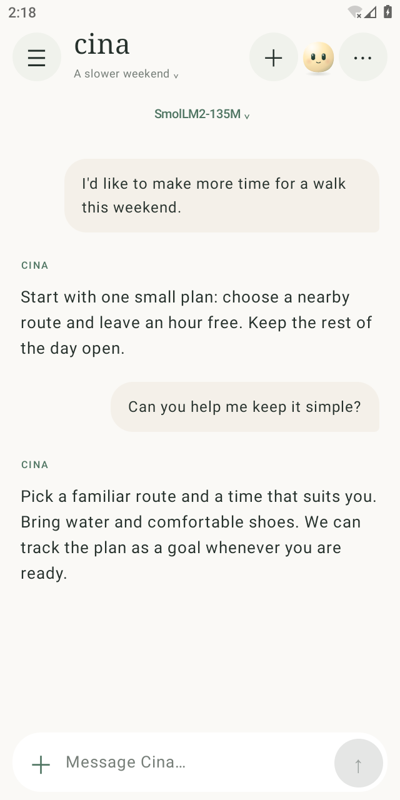
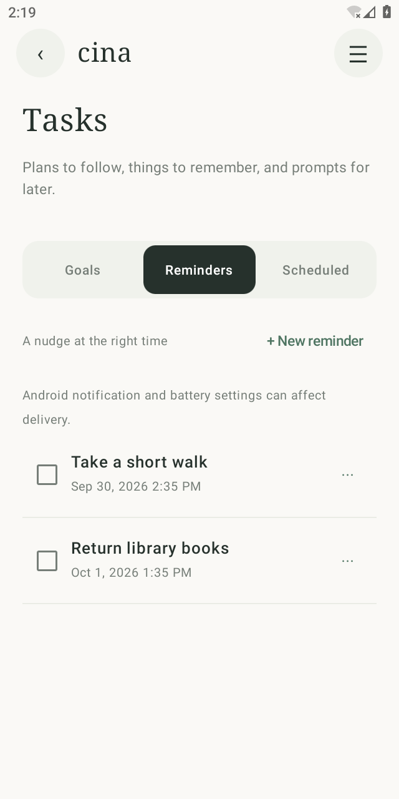
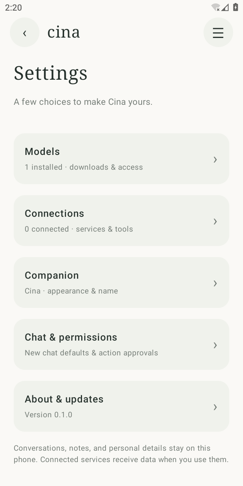

  
  <h1>Cina</h1>
  
<strong>A little space to think, right on your phone.</strong>

Cina is a text-first Android assistant that runs GGUF language models on your phone. It uses the official llama.cpp Android binding, local SQLite storage, and Kotlin/Jetpack Compose. Phone inference and personal storage stay on the device. An optional self-hosted Home companion runs larger local models and durable analysis jobs with selected chat excerpts and attachment passages. Internet search and connected tools use the network when you enable them.

## A look inside

| Chat | Tasks | Settings |
| :---: | :---: | :---: |
|  |  |  |

Tap a screenshot to see it full size. See the [full UI gallery](preview/ui-refresh/README.md) for navigation, notes, profile, memory, models, and connections. These captures show the Android app running on a disposable emulator with sample local data.

## What Cina can do

- **Readable replies.** Assistant replies render headings, bold and italic text, lists, quotes, strikethrough, tables, and code blocks, including while streaming. Code has a Copy button. HTTP/HTTPS links open in your browser when tapped. Raw HTML stays literal text and images show alt text without downloading anything.

- **Chat privately with local models.** Download recommended GGUF models, browse Hugging Face, import a file, or add a direct model URL. Once a model is installed, ordinary chat works offline. Benchmark an installed model to compare speed and a few short task checks on your phone.
- **Use your own home computer.** Download the [companion Compose file](companion/README.md#deploy-with-docker-compose), start it with Docker Compose, then pair it in Connections. Choose Phone, Heavy phone and Home models in Models; download Home models from the server catalogue or Hugging Face, and follow durable analysis jobs in Work. Assign a Home model to Deep analysis while keeping everyday and offline work on your phone.
- **Keep useful things close.** Save and search notes, set reminders, and review suggested memories before they become part of future conversations. An optional You profile lets you share the details Cina should remember about you.
- **Work with your files.** Attach a text document or a PDF to a chat. Cina indexes selectable text on the device and can cite the relevant file and passage in its answer.
- **Turn requests into goals.** Start a goal from chat, follow its plan and tool results in Tasks, and return to paused or waiting work. Goals keep their progress across app restarts.
- **Schedule local prompts.** Run a prompt once, daily, or weekly with a chosen on-device model. Cina saves the result and sends a notification when Android allows it.
- **Use helpful tools when you choose.** Search the web, create notes and reminders, or connect an HTTPS MCP service. Cina asks before actions that create or share data, unless you enable YOLO mode for that chat.
- **Reach Cina from the home screen.** Quick Note, Ask Cina, and Today widgets help you capture a thought, start a chat, or glance at upcoming reminders and the latest scheduled result.
- **Personalize the companion.** Choose its name, colours, eyes, hat, mouth, and accessories, including a custom colour, and set how Cina should respond.

## Build

Development roadmap: [Cina personal agent plan](docs/cina-personal-agent-roadmap.md) describes the proposed Muse-inspired experience, phone-first architecture, optional computer worker, implementation phases, and release gates. It is a plan for future work, not a list of shipped features.

The local **Inbox** accepts written text or Android **Share → Cina Inbox** for text, links, UTF-8 documents, and PDFs independently of chats. Capture works without a model or network; links are not fetched. Originals are retained up to 8 MB, with explicit preview limits and deletion controls. Interpret a saved item with the selected local model, inspect source quotes, edit/defer/discard suggestions, and keep a category. Keeping a suggestion does not execute it or add personal memory. **Knowledge & projects** now supports separate explicit fact promotion, correction history, validity, project links, and offline keyword retrieval with source references. It is not automatically added to chat context. See [capture](docs/inbox-implementation-2026-10-14.md), [review](docs/inbox-review-implementation-2026-10-14.md), and [knowledge/retrieval status](docs/context-library-implementation-2026-10-14.md). **Storage & backup** adds manual age-based cleanup and passphrase-encrypted library export/restore (32 MiB limit), with validation and confirmation before replacement. See [recovery scope and validation](docs/library-backup-implementation-2026-10-14.md). **Work → Actions** now supports durable, explicitly approved local note/reminder creation from kept Inbox actions or manual tasks. Plans support up to eight ordered local steps and a chosen start time. One approval covers the exact remaining steps and a 15-minute run window; verified steps survive retries without duplication. Existing scheduled model prompts now stage note/reminder suggestions for review in Actions. See [durable work scope and validation](docs/durable-work-implementation-2026-10-14.md). See [scheduled plans and step recovery](docs/work-plans-implementation-2026-10-14.md). **Work overview** now brings actions, reminders, scheduled prompts and chat goals together, with follow-up notifications and compact model controls for drafting, appending, scheduling and managing local plans. See [implementation and small-model evaluation](docs/work-overview-implementation-2026-10-14.md). Broader goal migration and optional computer delegation remain upcoming.

Requirements: Android SDK platform 36, NDK 29.0.13113456, CMake 3.31.6, JDK 21, and an arm64-v8a Android 10+ phone. `vendor/llama.cpp` is pinned as a submodule at upstream commit `66e665c4276ee46f3ec9872dd7e5a496842bc44f`. Clone with `git clone --recurse-submodules`, or run `git submodule update --init` after cloning.

Run `gradlew.bat :app:assembleDebug`. The debug APK is generated at `app/build/outputs/apk/debug/app-debug.apk`.

## APK releases and updates

Each push to `main` runs [the APK workflow](.github/workflows/android-apk.yml). It builds an arm64 release APK, stores it as a workflow artifact, and publishes it as the latest GitHub Release. The build number increases on every workflow run. Cina checks the latest release when opened, prompts when its build number is newer, and opens the APK download when you choose **Download**. You can also check from **Settings**. If the phone blocks installation, allow APK installs from the browser or file manager you used to open the download.

Before the first release, create and safely back up a dedicated Android signing keystore. Add these four repository secrets under **Settings → Secrets and variables → Actions**:

| Secret | Value |
| --- | --- |
| `CINA_KEYSTORE_BASE64` | Base64 encoding of the complete keystore file (no line breaks) |
| `CINA_KEY_ALIAS` | Alias of the signing key in that keystore |
| `CINA_KEYSTORE_PASSWORD` | Keystore password |
| `CINA_KEY_PASSWORD` | Key password |

On Windows, you can encode the keystore with `[Convert]::ToBase64String([IO.File]::ReadAllBytes('C:\path\to\cina-release.jks'))` in PowerShell. Keep the keystore and passwords backed up securely: future APKs need the same key to install over existing releases. The workflow stops before building if any signing secret is missing. APKs made by `assembleDebug` have a different signing key and cannot update to these release APKs without first uninstalling the debug app; uninstalling deletes its local app data. Install the first signed release to receive in-app update prompts for later builds.

## Navigation

- **Chat:** conversations and attached files, with a compact message composer. The **+** menu contains **Attach a file** and **Track as goal**.
- **Library:** one home for **Inbox**, **Notes**, **Knowledge & projects**, **Memory**, and captured-library **Storage & backup**. Personal memories and source-backed knowledge retain their existing separate review rules.
- **Work:** opens the unified progress/approval/result overview. Existing **Goals**, **Reminders**, **Scheduled**, and **Actions** editors remain available. Their execution paths have not yet been merged.
- **Settings:** profile/response preferences, models, connections, skills, appearance, permissions, and updates. **About you** opens the profile editor area.

Existing widgets, shares and notification links still open the relevant detail. The earlier UI gallery predates this change; [current menu and Library previews](preview/consolidation-2026-10-21/README.md) show the consolidation. The [deployable Home companion](companion/README.md) adds pinned HTTPS pairing in Connections, server models in the existing model picker/Models list, and durable analysis jobs in Work. An optional Home assignment for Deep analysis keeps everyday/offline requests on a phone model. Browser/desktop automation and repeating server jobs remain future work. See [the home companion design and model evaluation](docs/companion-and-consolidation-2026-10-21.md).

## First run

1. Open **Models** and tap **Phone model**, **Heavy phone model**, or **Home model**. Choose an installed model or a suitable download inside that choice. Hugging Face file lists have explicit **Download to phone** or **Download on Home** actions. Phone choices also support direct GGUF links and file imports.
2. Select an installed model. Chat works without network access after the model is installed.
3. In a chat, enable **Web** only if you want internet search. Cina searches DuckDuckGo without an API key. You can add a Brave Search API key in **Settings** as a fallback. Gated Hugging Face files require account approval and a token entered in Settings.
4. Notes, reminders, and scheduled tasks are stored inside Cina. In **Work → Scheduled**, choose a prompt, model, time, and optional daily or weekly repeat. Cina runs the prompt on the phone, can use its local note, reminder, and task tools, and notifies you of the saved result. Calendar, alarm, and share actions open Android system apps for the final user step.
5. To use remote tools, open **Settings → Connections**. For Linear, choose **Sign in with Linear** and approve access in your browser. Other services currently use an access token. Cina checks the connection and loads the server's tool list. Disconnecting deletes saved credentials.

## Home-screen widgets

Long-press the Android home screen, open **Widgets**, and find **Cina**. **Quick Note** opens a focused editor and saves the text directly to Notes; its first line becomes the title. **Ask Cina** opens a prompt field and sends the text in a new chat when you press Send. If no model is selected, the prompt stays in the new chat's input field so you can choose a model first. **Today** shows the next two open reminders and the latest scheduled task result. Tap the reminder area to open **Work → Reminders**, or the task result to open **Work → Scheduled**.

## Local response modes and timing

Auto is the default, with Quick and Deep overrides in chat. Assign local models for each mode in Settings → Responses, or use the same model for both. Quick disables thinking when the model template supports that control. Settings → Responses → Response timings shows local measurements for the last 30 runs without recording message content. See [response modes, memory processing, and the Fold 7 validation protocol](docs/local-response-performance.md).

## Goals, files, memory, and model benchmarks

- Choose **Work → Goals → New goal**, or type a request in chat, tap **+**, and choose **Track as goal** to track it in **Work → Goals**. Cina saves tool results and approval checkpoints with the goal. You can return to a paused or waiting goal, follow up, or mark it complete. Goal execution runs while the chat is active; closing the app preserves progress but does not keep that goal running in the background. Scheduled tasks remain a separate feature.
- Tap **+ → Attach a file** beside the chat input to add a text document or a PDF. Cina extracts and indexes selectable text locally, searches relevant passages when you ask about the file, and identifies the file and passage in its response. Supported text files include TXT, Markdown, CSV, JSON, XML, HTML, and logs. Files are limited to 8 MB; extracted text is limited to 250,000 characters. Scanned PDFs and images need OCR and are not supported yet. The searchable text is stored with the chat on this phone.
- **Library → Memory** shows proposed personal facts for review before saving them. Suggestions and saved facts show their source conversation. Cina also maintains a short rolling summary of older conversation turns for continuity.
- In **Settings → Models**, choose **Benchmark this phone** to test every installed model, follow progress, or stop the run. Results show generation speed and three short Cina task checks, with separate **Quick** and **Deep** model assignments. A model’s details also offer an individual **Benchmark**. These checks are a starting comparison; test real requests before relying on a model for important work.
- **Discover** loads popular text GGUF models from Hugging Face and checks single-file options against this phone’s memory and storage. Starting picks use download counts and file size; benchmark downloaded models to measure their performance here.

## Skills

Open **Settings → Skills** to enable, disable, or edit procedures for Remember details, Weekly planning, Research, Organizing notes, Daily check-in, Task breakdown, Decision support, Writing and editing, Document review, Weekly review, Memory maintenance, and Create a skill. Built-in instructions can be restored to defaults. Changes apply to the next response, including in an existing chat; editing is unavailable during a response.

Ask Cina to create a skill for a recurring workflow. It drafts a title, a description explaining when to use it, and instructions with steps and a completion check, then requests `create_skill`. The existing approval dialog shows all instructions before saving (unless you already allow that tool or use YOLO mode). Custom skills are enabled after saving and can be edited, toggled, or deleted in Settings. Up to eight custom skills are stored locally. Instructions are limited to 1,200 characters per skill. Repeating an identical creation does not add a duplicate; conflicting titles require editing the existing skill.

Interactive prompts include a compact procedure catalog and at most one matching procedure. Cina can load another enabled procedure with find_skill when needed. Skills do not grant permissions, enable web search, install external skills, execute scripts, or add capabilities. A larger enabled collection increases prompt size, and guidance still depends on the local model. Scheduled tasks cannot create skills or save memories. Memory maintenance reads saved facts with `search_memories` and suggests changes for review in Library → Memory.

When explicitly asked to remember a fact, Cina can request `save_memory`. Its approval shows the exact fact before saving, unless already allowed or using YOLO mode. Saved facts appear in **Library → Memory** with a source conversation and can inform future chats. Exact duplicates are skipped. Memory tools are unavailable while memory is off. All incidental facts are proposed for review. Extraction asks for a fact and a supporting quote; the app handles retention dates and duplicate checks. You can choose which existing fact a correction replaces. Temporary plans retain their source date and expire from active memory retrieval.

## Skill device checks

- Create a meal-planning skill, inspect its full approval, reject it, and verify nothing was saved.
- Approve it once; verify it appears immediately in Settings, persists after restart, and can be edited, disabled, and deleted.
- Repeat the same creation and check there is only one copy; try a conflicting title and verify the existing skill is unchanged.
- Test limits for titles, descriptions, instructions, and the custom-skill count. Built-ins cannot be deleted or overwritten by the creation tool.
- Ask for a daily plan, a task breakdown, or an attached-file review. Check that no unavailable tool use or unrequested writes are claimed.
- Turn memory off and confirm memory search and saving are blocked. Review memories and verify suggested corrections are not applied automatically.

## Connected services

Google connections use **Connect with Google**: choose an account and approve the selected service's permissions. Cina calls Google APIs directly for Gmail, Drive, Docs, Sheets, Slides, Calendar, Chat, and Contacts, without requiring users to create Cloud projects or paste tokens. Google Play services obtains fresh access tokens when needed. Account identities are encrypted on-device; Google tokens are not persisted by Cina or included in prompts or logs. Disconnect removes the local account association and disables its tools. **Manage Google permissions** opens Google's account controls to revoke Cina's grant across services.

App developers must register Cina's Android package/signing certificate, enable the APIs, and configure consent once before distributing a working Google-enabled build. See [Google connector release setup and supported actions](docs/google-connectors.md). Google sign-in requires Google Play services. Existing Google MCP tokens remain available under **Advanced options**; those legacy connections still require their own MCP configuration and manual token renewal.

Linear supports browser OAuth with automatic token renewal. GitHub accepts a personal access token. You can also add an arbitrary HTTPS Streamable HTTP MCP endpoint with a name, URL, and optional bearer token. A configuration containing a remote `url` can be used directly; a `command`/`args` configuration describes a local stdio server and must first be hosted behind an HTTPS endpoint. Custom credentials are encrypted with Android Keystore and removed on disconnect/removal.

Google's built-in tools and discovered MCP tools share the existing connected-action approval flow. Cina asks before running them unless the tool is always allowed or the chat has YOLO enabled. Service responses remain untrusted data. The MCP client supports HTTPS Streamable HTTP with the 2026-07-28 protocol and a legacy handshake fallback; it does not run local stdio servers or legacy HTTP+SSE endpoints.

The assistant requests confirmation before creating or sharing data, including scheduled tasks created through chat. Per-chat YOLO mode skips these confirmations for the app's available tools and displays an action log. It turns off when the app leaves the foreground or the user changes chats. Chat is the home screen. The side menu contains **Chat**, **Library**, **Work**, and **Settings**. Work groups progress, approvals and results; its specialized editors remain available. Library groups saved material and reviewed memories. Profile and response preferences are under Settings → About you. Settings opens focused screens for models, connections, companion appearance, chat permissions, and updates. Tap the model name in chat to switch between installed models or manage downloads. The companion avatar opens its appearance editor directly.

## Current boundaries

- GGUF text chat models only. Import validation checks GGUF structure; llama.cpp decides whether an architecture can run on this device.
- Reminder notifications are inexact and depend on Android notification permission and battery policy.
- Scheduled tasks run locally through Android's persistent work scheduler, so the actual start time can be later than requested. Each run can make up to three writes and eight reads (with a separate discovery budget) and produces a text response; connected-tool and Android screen actions are unavailable in the background. The selected model must remain on the phone. Long model runs can be interrupted by Android and may need another attempt.
- Web search sends its query to DuckDuckGo. If that search fails and a Brave key is saved, Cina retries with Brave. Search results are treated as untrusted input to the local model.
- No cloud inference, voice, accessibility automation, or background autonomous agent. Connected MCP services do exchange data with their providers when used.
- Goals survive app restarts, but only scheduled tasks execute while the chat is closed. Attached files are currently indexed by extracted text; scanned pages, images, and other binary formats are not interpreted.
- Device performance and memory use vary by model. The app gives an estimate before download; test on target phones before distribution.

## Usability and action reliability

The [October 2026 implementation notes](docs/usability-fixes-2026-10-13.md) describe the audit fixes and validation limits.

- Open the chat title for search, rename, archive, delete, and Markdown export. Deletion removes attached text, summaries, pending suggestions, and goal history; you choose whether saved memories are also deleted. Notes and reminders remain independent.
- Tap the attached-file count to read extracted text or remove a file. Notes can also be exported through Android's document picker.
- Action previews show complete editable values, nested connected-service arguments, resolved note/reminder titles, and local dates. Persistent permission is a separate, off-by-default choice.
- Interrupted requests offer Retry and Edit. Approvals and execution receipts survive restart. Exact completed calls return their saved receipt; uncertain calls are blocked. New writes during recovery require review, even with automatic actions enabled.
- Schedules support editing, changing the model, Run now, and Retry. Manual runs preserve the regular schedule. Notification access is requested where it is needed, rather than at startup.
- One typed tool catalog supplies instructions, argument validation, labels, availability, and the native action grammar. Discovery/read budgets no longer consume the write budget. Long notes have paged reads, version checks, and append/partial edits.
- The grammar constrains action syntax; it cannot make an unsuitable model understand a task or choose the right action. Test models on the target phone before relying on their actions.
