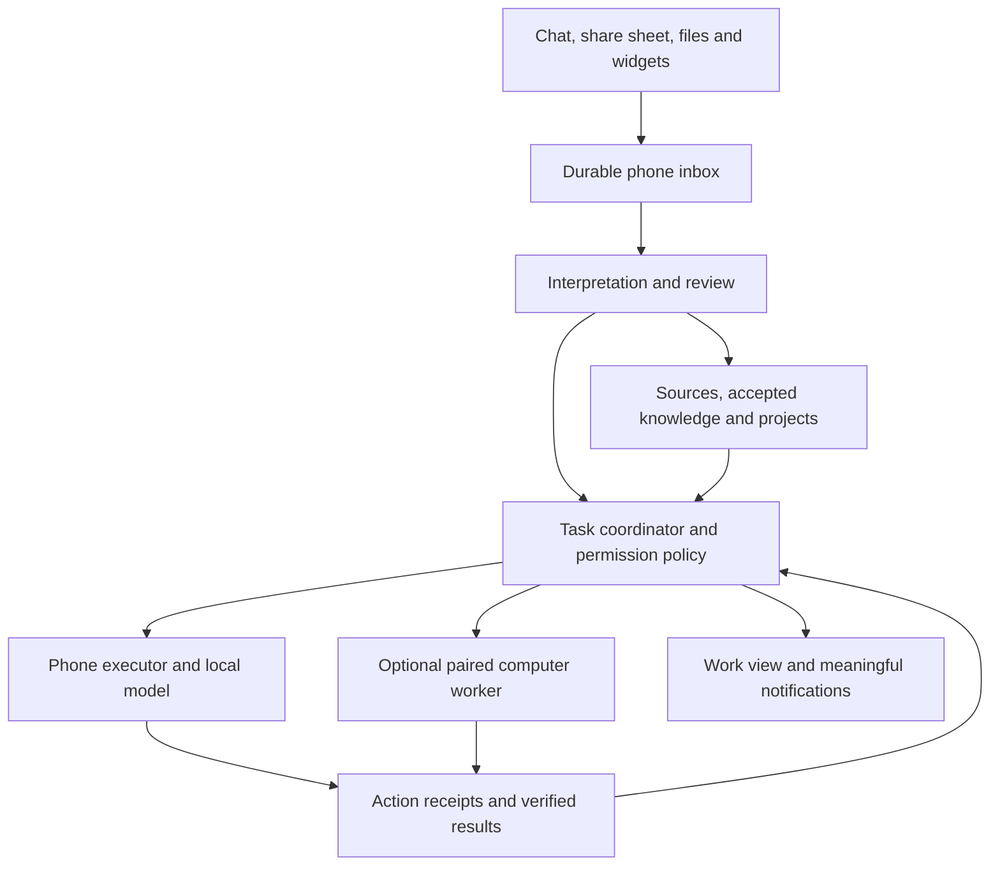

# Cina personal agent: product and implementation plan

Date: October 13, 2026
Baseline: repository commit `1d460ab`, database version 7
Status: proposed delivery plan; the capabilities described as future work are not implemented.
Scope: a Muse-inspired personal experience, local on the phone with an optional computer owned by the user.

## 1. Product outcome

Cina receives the information you choose to share, understands its significance, organizes it into your personal context, and follows through on authorized work. It preserves the source, makes its interpretation editable, and shows what actually happened.

The product should feel like one assistant across two execution locations. Routine use should not require choosing a model, understanding agent frameworks, or managing a server. The phone remains useful without the computer. The optional computer enables deeper analysis and longer-running work with local inference.

The primary loop is:

**Receive → understand → organize → act → verify → follow up.**

The measure of success is completed, useful work with understandable evidence and little correction. Chat quality, model speed, and connector count support that outcome; none establishes it on its own.

### Agreed direction

- Phone first, with optional compute on a computer the user owns.
- Local inference and local storage by default; no automatic fallback to commercial cloud inference.
- One place to relay information and ask Cina to handle it.
- Source material, accepted personal knowledge, and active commitments remain distinct.
- Reviewable interpretations and clear permissions for consequential actions.
- Proactive follow-up should surface meaningful changes rather than routine status noise.
- Muse supplies product inspiration. Hermes and OpenClaw are potential implementation components, not the user-facing identity or a requirement for phone operation.

### Initial boundaries

The first release covers explicitly shared text, links, and selectable-text PDFs. It does not promise universal access to every app, passive collection of everything on the phone, continuous microphone recording, arbitrary purchases, or unattended control of arbitrary applications. Images/OCR, voice, richer artifacts, and broader automation follow after the core loop works.

“Share everything with Cina” means a low-friction place for information the user chooses to provide, with storage controls and clear unsupported-format handling. It is not unlimited ingestion or blanket authorization to act on every instruction inside a document.

## 2. Target experience

### Everyday scenarios

| Scenario | Expected result | Completion evidence |
| --- | --- | --- |
| Share a school email: “Handle what I need to do.” | Extract relevant dates, associate the source with the correct project/person, propose tasks and reminders, draft a reply if requested. | Source quotations, saved item links, pending approval for external sending. |
| Paste several thoughts: “Sort this out.” | Separate reference information from actionable requests, suggest grouping, identify missing details. | Editable interpretation and a visible filing result; uncertain items remain unresolved. |
| Share a PDF: “What do I need to do?” | Extract obligations with page/passage references and propose a checklist. | Each proposed obligation points to evidence; missing/scanned text is identified. |
| Ask a question weeks later | Retrieve relevant accepted knowledge and source passages. | Answer citations, dates, and an indication of conflicting or outdated information. |
| Request a researched comparison | Delegate bounded research to the paired computer when enabled, return a report and sources. | Saved artifact, source references, task history, and a clear completion result. |
| “Watch this and tell me if it changes.” | Save a specific condition and schedule, evaluate changes, notify only when relevant. | Baseline, last successful check, detected change, and next check. |
| Share while offline | Save immediately and allow local processing when resources permit. | Durable inbox item; computer/network work visibly queued. |

### Navigation proposal

Keep Chat as the familiar home. Add features incrementally rather than replacing navigation in the first change.

| Surface | Purpose |
| --- | --- |
| Chat | Talk to Cina; capture, ask, steer, correct, and see concise results. |
| Inbox | Shared items awaiting processing or review. Cards show what Cina understood and what needs attention. |
| Work | Unified view of goals, actions, reminders, recurring work, and pending approvals. |
| Library | Source material, notes, and projects, searchable with source links. |
| You | Reviewed personal knowledge, preferences, retention choices, and corrections. |
| Settings | Models, computer pairing, connections, permissions, storage, and updates. |

Sources can be linked to several projects without duplicating their contents. A person/project association is a suggestion until sufficiently grounded or confirmed. Never silently merge people with similar names.

### Intake card

Each processed item should answer five questions: What did Cina receive? What did it understand? Where will this go? What actions are proposed? What still needs input?

Primary controls: accept selected changes, edit, ask Cina, defer, and discard. Users can inspect the original source and evidence without navigating through a long chat. Capture itself is immediately confirmed; processing is a separate visible state. No model needs to be installed to save an inbox item.

## 3. Existing foundation and gaps

| Area | Reuse | Required change |
| --- | --- | --- |
| Android experience | Compose screens, chat, widgets, notes, reminders, profile | Inbox, interpretation cards, unified work activity, artifact views |
| Local inference | `AssistantRuntime`, `ModelAccess`, Quick/Deep policy, llama.cpp | Capability evaluation, task-aware routing, structured extraction, isolated execution ownership |
| Persistence | `LocalStore`, saved turns, goals, schedules, tool receipts | Sources independent of chats, proposals, task steps, durable events and transfers |
| Memory | Reviewed facts, evidence extraction, expiry and corrections | Source-backed knowledge across captures, projects and tasks; richer retrieval |
| Files | `AttachmentImporter`, text/PDF extraction and passage search | Independent source storage, raw-file retention, page/offset provenance, explicit truncation |
| Actions | `ToolCatalog`, argument validation, editable approvals, write receipts | Shared execution service, risk/scoping policy, outcome verification |
| Background work | `ScheduledTaskWorker`, reminders and persistent scheduling | Short resumable steps, distinct wait states, triggers and quiet delivery |
| Connections | HTTPS MCP, Keystore-backed secrets, Linear OAuth | Selected provider sign-in, fine-grained action classification, revocation and reconciliation |
| Testing | JVM, instrumentation, native tool-cycle and recovery coverage | Real-device workload suite and cross-device failure tests |

Current goals are saved records and chat execution, not a continuous background service. Scheduled runs have an eight-minute timeout and a restricted local tool catalog. The native inference engine is shared through one mutex, and current context is capped at 8,192 tokens. Existing file attachments retain extracted text; a complete original-source archive requires new storage.

Existing action receipts protect exact calls and block uncertain outcomes. They do not prove semantic equivalence between differently worded actions or establish exactly-once execution at an external service. Preserve these protections while extending them.

Historical verification is recorded in the audit and tool-reliability documents. It is not a fresh benchmark of this plan, the current phone, or a computer worker.

## 4. Architecture and ownership



### Phone responsibilities

The phone owns canonical personal sources, accepted knowledge, project organization, permissions, and user-visible task definitions. Keep these records in local transactional storage. The interface can reconstruct activity from durable events after process death. Chat is one way to control work, not the lifetime of the work itself.

Extract task execution from `AssistantViewModel` into a service used by chat and workers. Retain a single phone inference queue with interactive requests prioritized over extraction, summaries, and other housekeeping. Phone jobs checkpoint between bounded steps and respect Android scheduling. Do not promise exact-time or uninterrupted execution.

### Computer responsibilities

The computer owns the execution journal and sandbox for jobs explicitly assigned to it. It receives a bounded context package and permitted files, runs a local model, and returns events, proposals, artifacts, and receipts. It cannot directly update the phone's database or silently promote observations into accepted personal knowledge.

Start with one phone and one paired computer. Exclude general multi-device editing and multi-user workspaces from version one. On the phone, distinguish “queued for computer,” “working on computer,” “computer unreachable; status unknown,” and “completed.” An unreachable worker is not proof that work stopped.

### Routing

Default routine capture and short tasks to the phone. Offer a simple setting allowing deeper tasks on the paired computer, and retain a per-task “keep on phone” option. Show the execution location in task details. If the computer is unavailable, queue work or offer a smaller local alternative; never silently route to a cloud provider.

Audit every selected runtime's auxiliary models, summarizers, memory services, search tools, telemetry, and fallback routes. Using a local main model alone does not establish an entirely local processing path. Network tools remain explicit, and external providers receive the minimum task data needed.

### One executor per action

- Give tasks, attempts, actions, and transfers stable globally unique IDs. Reuse action IDs across retries; a deliberate repeat creates a new action.
- Persist delegation before transmission and acknowledge it on the computer before showing it as accepted. Repeated submission returns the same job.
- Use execution ownership, command revisions, bounded grants, and acknowledged cancellation. A lost connection or expired lease must not cause automatic duplicate execution on the phone.
- The phone remains authoritative for the task definition; the assigned executor remains authoritative for what its attempt actually did. Reconcile receipts and revisions on reconnect.
- A stale worker may return historical evidence, but cannot acquire fresh authority to mutate current state.
- External APIs may not support fencing or idempotency. Reassignment of uncertain writes requires reconciliation or user resolution, not a generic retry.

## 5. Proposed data model and contracts

Names below are proposed domain concepts, not commitments to exact SQL table names. Use additive, versioned migrations from the existing version 7 schema; allocate actual schema versions per delivered change.

| Record | Essential contents |
| --- | --- |
| Source | ID, type, originating app/URL, capture time, source date/timezone where known, hash, retained original, extraction version, trust and retention metadata |
| Source passage | Source ID, text, page or offsets, extraction limitations and citation locator |
| Intake item | Source IDs, user instruction, processing state, error, revision and interpretation version |
| Proposal | Fact/category/action, exact evidence, uncertainty/missing fields, target record, review state and user edits |
| Knowledge fact | Accepted content, linked evidence, validity dates, replacements, revision and review history |
| Project/entity | Name, aliases, explicit relationships, source links and merge history |
| Work item | Objective, source links, completion criteria, status, owner, priority, deadline/timezone, next wake and budgets |
| Work step | Dependencies, required capabilities, attempt state, planned action, outcome and verification |
| Approval/grant | Action ID and argument hash, destination, scope, validity, issuer, decision and consumption state |
| Action receipt | Logical action ID, executor, request hash, attempted/completed/uncertain state, external identifier and evidence |
| Artifact | Version, type, producing task, local location, hash, preview and export metadata |
| Device/job event | Paired identity, protocol capabilities, job ID, command revision, event sequence and reconciliation cursor |

Normalize timestamps as instants while preserving the source phrase and relevant timezone. Separate a document date, a deadline, a reminder time, and a memory expiry date. Ask about ambiguous commitments instead of inventing a time.

### State transitions

Intake: `captured → queued → processing → needs_review → organized`; failures are retryable and dismissal is explicit. Reprocessing creates a new proposal revision without silently applying it.

Work: `draft → ready → queued → running → verifying → completed`. Work can move to `waiting_for_input`, `waiting_for_approval`, `waiting_for_device`, `waiting_for_network`, `paused`, `failed`, `cancel_requested`, `cancelled`, or `needs_reconciliation`. Resumption goes through eligibility and permission checks. A generated answer cannot alone mark an action complete.

Keep overall task status separate from step/attempt status. A failed step must not erase confirmed earlier results. Cancellation stops future work after acknowledgement; it does not undo an action already completed.

### Computer protocol

Expose a narrow Cina-owned contract: pair/unpair, capabilities, submit job, inspect status, read events, request/resolve approval, cancel, reconcile, fetch artifact, and delete retained job data. Select exact endpoints during the implementation spike.

Submission includes IDs, protocol version, objective, evidence references, permitted capabilities, data-retention instructions, budget and expiry. Events include job/attempt IDs, monotonically increasing sequence, state and evidence references. Reconnect can replay durable events; gaps trigger reconciliation. Enforce transfer size, type and hash checks. Rendering an artifact never grants it network or native-app privileges.

Do not equate an OpenAI-compatible text response endpoint or a generic MCP connection with this full job contract. Adapters must implement the lifecycle and expose unsupported capabilities honestly.

## 6. Permission and privacy behaviour

| Operation | Initial behaviour |
| --- | --- |
| Capture explicitly shared material | Save locally without an inference approval round-trip. |
| Read, summarize and suggest grouping | Allowed within the submitted scope; reversible organization can use an explicit user preference. |
| Save incidental personal facts or merge conflicting knowledge | Present a reviewable proposal. |
| Create local reminders/notes from a request | Use existing approval, later permitting narrowly scoped standing grants. |
| Fetch a shared URL or use web search | Require enabled network capability; record destination and source. Sharing a URL alone need not fetch it. |
| Read a connected account | Require account authorization and applicable task scope. |
| Send, publish, purchase, delete external data or alter permissions | Fresh exact-action approval in the initial connected release. |
| Add or revise learned procedures | Versioned proposal; test before activation; no expansion of permissions. |

Enforce policy below the model and at each executor. Bind approval to the actual destination and arguments; editing those invalidates it. Imported files and tool output remain untrusted data and cannot authorize actions. Current chat YOLO settings must not silently become standing permissions for background or delegated work.

For the initial computer release, keep consequential external actions blocked until the phone is online and can authorize the exact operation. Revocation/cancellation while disconnected is visibly pending; immediate remote revocation cannot be guaranteed. Limit the lifetime of preauthorized read-only jobs.

Keep credentials outside prompts, memory, logs, artifacts, and general execution workspaces. Separate the worker's model/tool environment from the broker that enforces grants. When enabling scripts/browser automation, restrict filesystem and network access so those tools cannot bypass the broker. A UI approval dialog alone is insufficient enforcement.

New source retention must include storage limits, deletion, export, and recovery. A deletion flow explains the effect on excerpts, indexes, summaries, facts, artifacts and paired copies. Preserve a user-authored fact only if the user chooses to retain it independently. Use deletion markers so an offline computer does not restore deleted data when it reconnects. Show outstanding remote deletion acknowledgements.

App-private SQLite is not equivalent to application-level encrypted storage. Review at-rest protection, OS device protection, optional database/file encryption, and recoverable key handling before broad personal use. Provide encrypted user-controlled backup/export; do not rely on Android backup, which is currently disabled. Never export live connection tokens by default.

## 7. Delivery phases and completion gates

Implementation began October 14, 2026 with CINA-001–003. See the [first-slice implementation record](inbox-implementation-2026-10-14.md) for shipped local code, validation evidence, and remaining gates. P0 and P1 are in progress; later phases remain not started. Estimates below are relative sizes: S = contained change, M = several related changes, L = substantial subsystem. They are not calendar promises. Establish dates after the baseline and computer spike reveal hardware and integration constraints.

### P0 — Baseline, fixtures and product contract (M)

Deliverables:

- Select the target phone and first computer OS/hardware; record available RAM/GPU, storage and availability expectations.
- Create a versioned set of 30 representative, synthetic or consented captures and 10 complete workflows, with expected facts, permissible actions and source references.
- Record current phone cold/warm response time, extraction/tool success, memory use, battery and thermal behaviour using a fixed model/configuration.
- Define source lifecycle, action risk categories and task status vocabulary. Sketch intake and work cards with fixtures.
- Add local feature flags for inbox, work engine and computer delegation; no automatic migration of active workflows until tested.

Gate: reproducible fixtures, recorded baseline, agreed initial supported inputs, and no claims based solely on the current three-question model benchmark.

### P1 — Durable capture and a useful Inbox (L; depends on P0)

Deliverables:

- Android share target for text, URLs and supported files; connect chat and widgets to the same intake path.
- Copy accepted file content while access is available; do not depend on temporary share permissions remaining valid.
- Source storage independent of chat lifetime, extraction limits, content hashes and duplicate suggestions.
- Structured interpretation into summary, proposed filing, candidate facts, possible actions and missing details, each linked to evidence.
- Review/edit/defer/discard UI. Proposals do not execute tools or silently enter permanent memory.
- Preserve source page/offset references; expose extraction truncation and unsupported/scanned documents clearly.

Gate: capture works without a model or network; process death cannot lose a confirmed capture; repeated sharing does not silently create repeated actions; editing an interpretation persists and changes the accepted result.

Demo: share a PDF and a message, reopen the app, review a grounded checklist and correct a date before accepting anything.

### P2 — Personal context and retrieval (L; depends on P1)

Deliverables:

- Link sources, notes, knowledge and work to projects and optional people; provide merge/unmerge and revision history.
- Extend reviewed memory with source links, conflicting claims, validity and correction propagation.
- Add full-text retrieval and structured filtering first; evaluate local embeddings only if they improve the held-out retrieval set enough to justify their resource cost.
- Answer across captures with cited evidence and explicit uncertainty. Retrieve small relevant context packages rather than append the entire archive to prompts.
- Retention/storage controls, encrypted backup/export and verified restore for the new records; deletion handling for all local derived records.

Gate: answer the retrieval fixture set with correct source references; corrections supersede old facts; deleted material cannot reappear through local indexes or summaries; restore preserves links and review history.

Demo: ask about an earlier commitment, correct it, and verify the next answer uses the correction while retaining its history.

### P3 — Unified work engine and phone follow-through (L; depends on P1–P2)

Deliverables:

- Extract execution from the view model into a coordinator, policy service, executor and outcome verifier.
- Add work items, bounded steps, durable events, explicit wait states, deadlines, cancellation and execution budgets.
- Route approved intake actions, chat goals and eligible schedules through the same service. Adapt existing reminders and schedules without firing them twice.
- Preserve receipt replay, uncertain-write blocking, argument validation and bounded repair. Add transactional local writes with receipts where possible.
- Separate user answers from completion evidence. Deterministically verify local writes; require reconciliation for uncertain external results.
- Present one work overview and activity history, with concise chat updates.

Gate: capture → review → local note/reminder → verified completion works with restarts at every boundary. Waiting approvals survive restart; denial causes no side effect; expired or edited approvals cannot be replayed.

**Release A: useful standalone phone agent.** This is the first complete product milestone and requires no computer or hosted inference.

### P4 — Optional computer and deeper local work (L; depends on P3)

Deliverables:

- Time-box an integration spike against a pinned Hermes release; evaluate OpenClaw with the same tasks if Hermes fails a required contract or device/channel capabilities become decisive.
- Record an architecture decision with observed results. Reuse a runtime only if it can enforce Cina's lifecycle, local-inference policy and permission boundary.
- Implement secure pairing, protocol/capability negotiation, device revocation, job submission, event replay, cancellation, artifacts and retention acknowledgements.
- Support local inference and read-only analysis of explicitly transferred material first. No ambient access to the computer's full home directory or credentials.
- Add automatic task routing within user settings, offline queues, execution ownership and reconnect reconciliation.
- Verify backend helper/judge models also use approved local routes. Package installation, updates, health checks and a stop control for the chosen host platform.

Gate: the same job can be submitted repeatedly without duplicate execution; phone disconnection leaves valid worker work intact; computer restart reports interruption honestly; reconnection restores results and approvals; a stopped or unpaired worker cannot start fresh actions.

Demo: delegate a comparison of several documents, close Cina, reopen it, and receive a cited report. Repeat with the computer shut down midway and verify recoverable status.

**Release B: one assistant across phone and personal computer.**

### P5 — Connected actions and richer deliverables (L; depends on P4)

Deliverables:

- Choose two services based on actual recurring use. Provisional candidates are calendar and email; begin with reads and local drafts, then narrowly approved writes.
- Complete OAuth renewal, revocation, read/write/sensitive classification, rate-limit handling and outcome verification for those services.
- Surface exact recipient/account/content or event details on the phone. The computer's policy layer enforces the approved operation.
- Add artifact records, previews and exports for reports and checklists, then template-based PDF/document generation.
- Introduce a sandboxed browser only for workflows where service APIs are insufficient. Handle login handoff, changed pages, failed submissions and uncertain outcomes explicitly.

Gate: controlled test-account workflows complete with evidence; changed recipients/arguments require new approval; token expiry pauses safely; a timeout after a successful write cannot cause an automatic duplicate. Opening an Android editor is recorded as a handoff, not a verified save.

Demo: turn a shared request into a proposed calendar item and draft reply, approve one, reject the other, and inspect the actual provider result.

### P6 — Meaningful proactivity and learned routines (L; depends on P3, with connected monitoring after P5)

Deliverables:

- Add daily/weekly reviews, explicit watch conditions, deadlines and recurring goal checks.
- Store last successful observation, comparison baseline, next wake, quiet hours, delivery history and per-routine budgets.
- Notify on meaningful change, completion, approaching commitment, failure requiring action, or an approval need. Batch routine information into a digest.
- A failed check is not “nothing changed.” Show stale observations; do not advance the baseline on an unsuccessful fetch.
- Turn repeatedly useful workflows into proposed versioned procedures. Require review and fixture checks before activation; retain rollback.

Gate: repeated unchanged checks remain quiet; genuine changes notify once; missed schedules and timezone changes reconcile without notification floods; pause takes effect without deleting history.

**Release C: proactive personal agent for a bounded set of real workflows.**

### P7 — Broader capture, accessibility and release hardening (L; builds on Release C)

Deliverables:

- Add screenshots/OCR and scanned PDFs with selectable evidence, followed by explicit voice-note capture and local transcription where viable.
- Apply the same intake/review contract to every modality. Surface uncertain names, amounts and dates.
- Validate TalkBack, large text, landscape/foldable layouts and interruption-heavy daily use.
- Improve setup, diagnostics, storage pressure handling, model selection, encrypted recovery and worker updates.
- Review action/network isolation before adding arbitrary scripts, wider browser access or more services. Purchases remain a separate future scope decision.

Gate: modality-specific quality targets pass; full restore and migration exercises pass; target-device performance and usability are recorded; release documentation describes actual capabilities and limits.

## 8. Backend selection criteria

Hermes is the first evaluation candidate because its documented API includes runs, progress, approvals, stopping, jobs and retryable submission. OpenClaw is the alternative when gateway/device/channel integration provides a stronger fit. These are hypotheses to validate against a pinned release, not proof that either meets the entire contract.

| Required capability | Evaluation evidence |
| --- | --- |
| Fully local inference path | Inspect provider configuration and observe main, judge, summary and memory calls; cloud fallback disabled. |
| Recoverable job lifecycle | Disconnect clients, restart the service and reconcile run IDs, partial results and final status. |
| Approval enforcement | Deny an action, alter arguments after approval, replay an approval and attempt a bypass through another tool. |
| Narrow data access | Worker cannot read unrelated files or credentials, or transmit data outside the permitted path. |
| Local-model usefulness | Complete the same workflow suite with the same model/hardware; measure quality, latency and resource use. |
| Maintainable integration | Version/capability checks, reproducible install, supported host platform, update/rollback and license/dependency inventory. |

OpenClaw's documented `mcp serve` interface is stdio and focuses on routed conversations; it is not a drop-in HTTPS job service for Cina. Its Gateway client protocol is a more complete integration candidate. Hermes APIs also require an adapter and tested policy mapping. Avoid installing both as simultaneous coordinators of the same work.

## 9. Validation and release criteria

The following are proposed release targets, not measured results. P0 establishes baselines; record any target revision with a reason before evaluating a release. Keep a held-out set so prompt changes are not judged only on examples used to build them.

| Measure | Initial gate |
| --- | --- |
| Capture durability | Zero lost confirmed captures in the defined process-death/restart suite. |
| Grounded extraction | At least 95% precision and 85% recall on supported fact/action fields in the labelled set; report abstentions separately. Every accepted generated fact/action has a source or explicit user instruction. |
| End-to-end usefulness | At least 90% completion on feasible, fully specified supported workflow cases. Evaluate deliberately ambiguous/blocked cases separately: they must stop at the correct boundary. Unnecessary abstention does not count as completion. |
| Approval integrity | Zero unauthorized side effects across all defined denial, stale-approval, injection and replay tests. |
| Duplicate prevention | Zero duplicate local writes in crash/retry tests; external uncertain outcomes always reconcile or block. This is not a universal exactly-once claim. |
| Capture responsiveness | Text capture acknowledgement target: p95 under one second, excluding subsequent model processing; measure file capture separately. |
| Phone resource use | Set concrete latency, RAM, battery and thermal limits from P0 device measurements. Interactive capture must not wait for background inference. |
| Proactive delivery | Zero duplicate alerts in replay tests and silence for unchanged routine checks. Record actual notification delivery delay. |
| Recovery | Restore sources, accepted knowledge, work, evidence and settings; require reauthorization or secure re-pairing for credentials/devices. |

Required failure cases include: app killed before/after commit; reboot; notification permission denied; no model; removed model; oversized file; scanned document; malformed extraction; ambiguous date; daylight-saving change; duplicate share; conflicting fact; injection inside a source; revoked connection; expired approval; provider timeout after write; worker disconnect before acknowledgement; worker restart; stale worker result; cancellation during a write; artifact hash mismatch; storage full; deletion while the worker is offline.

Use deterministic tests for policy and state transitions, instrumentation for persistence/UI, and real-model tests for extraction and tool choice. Existing regression suites remain required when their code paths change. Emulator success does not substitute for target-phone thermal/battery checks or controlled real-service validation.

## 10. Migration and rollout

- Preserve current chats, notes, reminders, memories, attachments, schedules and receipts. Add compatibility mappings instead of destructive conversion.
- Legacy attachments become sources with an explicit “extracted text only; original unavailable” flag. Do not fabricate original-file provenance.
- Preserve legacy approvals under their existing scope; never reinterpret them as broader computer/background grants.
- Convert or adapt legacy schedules transactionally with a stable occurrence identifier. Only one scheduler may own an occurrence during transition.
- Introduce each capability behind a flag and use interpretation-only mode before enabling new writes. Never run old and new mutation paths together for comparison.
- Validate upgrades from representative version 7 databases and each new version. Create a recoverable snapshot before migration; test forward recovery rather than assume an older binary can read a newer schema.
- Use reviewed branches/PRs. The current `main` push workflow publishes an APK release, so merging to `main` is a release action and should happen only after the relevant gates pass.
- Update README/screenshots to describe delivered behaviour only. Keep this document as the roadmap and link release evidence from its tracker.

## 11. Initial implementation backlog

| ID | Work package | Depends on | Done when |
| --- | --- | --- | --- |
| CINA-001 | Baseline fixtures, metrics and target-device record | — | P0 evidence is reproducible. |
| CINA-002 | Source/intake/proposal schema and version 7 migration tests | 001 | Sources survive chat deletion and upgrades preserve existing data under the defined lifecycle. |
| CINA-003 | Android share capture and durable inbox list | 002 | Supported content is captured offline and survives restart. |
| CINA-004 | Structured interpretation with passage evidence | 003 | Invalid/unsupported extraction fails visibly; grounded proposals pass fixtures. |
| CINA-005 | Editable review card and accepted organization | 004 | Edits, rejection, deferral and repeat processing preserve intent. |
| CINA-006 | Projects, knowledge revisions and retrieval | 005 | Cross-source retrieval and correction tests pass. |
| CINA-007 | Retention, deletion, encrypted export and restore | 006 | Lifecycle and recovery tests pass. |
| CINA-008 | Shared work coordinator, policy and step persistence | 005, 006 | Work runs independently of the chat screen with explicit states. |
| CINA-009 | Local action verification, recovery and schedule adaptation | 008 | Crash/retry/approval tests pass without repeated actions. |
| CINA-010 | Unified work UI and Release A device validation | 007, 009 | Standalone phone workflow meets release gates. |
| CINA-011 | Pinned backend spike and selection decision | 008 | Backend criteria have observed evidence and a recorded choice. |
| CINA-012 | Pairing, job protocol and first computer executor | 010, 011 | Bounded read-only job completes on a paired computer. |
| CINA-013 | Reconnect, cancellation, retention and artifact reconciliation | 012 | Release B failure matrix passes. |
| CINA-014 | Two selected connectors with exact-action approval | 013 | Controlled account workflows verify results and handle uncertainty. |
| CINA-015 | Recurring reviews, monitors and quiet notifications | 009; 014 for connected work | Release C proactivity gates pass. |
| CINA-016 | Reviewed reusable routines | 015 | Versioned procedures pass tests and can be rolled back. |
| CINA-017 | OCR, voice and broader device validation | 013, 015, 016 | Expanded capture meets the same provenance and review contract. |

These IDs are local planning references; no external issues or tasks have been created. Each package may need several small PRs. Keep storage migrations, execution changes and UI changes reviewable; do not combine the whole transformation into one rewrite.

First implementation slice: **CINA-001 through CINA-003**. Deliver durable capture and an inbox before introducing inference-driven organization or autonomous writes. Then complete the interpretation/review loop through CINA-005.

## 12. Decisions and tracking

| Decision | Current position | Resolve by |
| --- | --- | --- |
| Product and deployment | Phone-first personal agent; optional owned computer | Agreed in this conversation |
| Default data/model routing | Local only, explicit external tools | Adopt for implementation |
| Initial inputs | Text, URLs, selectable-text PDFs | P0 fixtures |
| Target computer OS/hardware | Not yet selected; current development host does not determine deployment | Before P4 spike |
| Computer runtime | Hermes first evaluation; OpenClaw alternative; keep adapter replaceable | CINA-011 |
| Initial connected services | Calendar/email provisional, based on actual user workflows | Before P5 |
| Memory/organization automation | Reviewed knowledge; optional bounded reversible filing | P1–P2 usability review |
| Storage budget and retention defaults | Choose from real capture volume; provide visible controls | P0/P2 |
| Backup key recovery and at-rest encryption | Explicit design and restore exercise required | CINA-007 |
| Hardware/model selection | Choose from end-to-end evaluations, not popularity or parameter count alone | P0 and CINA-011 |
| Remote access away from home | Authenticated encrypted access; private-network route first | P4; before external availability claims |
| Delivery dates | Set after baseline/spike; prioritize gates over speculative dates | After P0, revise after CINA-011 |

For each package, record status, branch/PR, migration version, test evidence, device/model configuration, known limits and next action. Mark complete only when its gate is demonstrated. User workflow priorities can change ordering, but permission, persistence and ownership gates remain prerequisites for broader actions.

Use this record when a package starts:

```text
Package: CINA-___
Status: not started / in progress / validating / blocked / complete
Branch or PR:
Schema and protocol versions affected:
Device, model and runtime versions:
Acceptance evidence:
Known limits or blocker:
Next action:
```

The user authorized implementation on October 14, 2026. CINA-002/003 have an emulator-validated capture implementation; CINA-001 measurements remain open. CINA-004/005 have [interpretation and review](inbox-review-implementation-2026-10-14.md), with broader model-quality/device gates still open. The core CINA-006 [knowledge, projects, and retrieval implementation](context-library-implementation-2026-10-14.md) follows; it does not complete the broader P2 answer-generation, organization, and recovery gates. CINA-007 now has [bounded library retention and encrypted recovery](library-backup-implementation-2026-10-14.md), including replacement previews, transactional restore and stale-preview checks. Physical-device and document-provider release checks remain open. CINA-008 and initial CINA-009 now have [durable single-step local actions](durable-work-implementation-2026-10-14.md): exact-action approvals, WorkManager execution, transactional read-back receipts and recovery. CINA-009 now adds [ordered local plans, scheduled starts and step recovery](work-plans-implementation-2026-10-14.md), including scheduled-prompt suggestions routed to approval. Legacy model inference and chat goals have not migrated. CINA-010 now has an initial [unified overview, follow-up notifications and model controls](work-overview-implementation-2026-10-14.md), with model-quality and physical-device release gates still open. The full P3 gate remains open. The staged release gates above still apply.

## 13. References

Repository baseline: [README](../README.md), [response performance](local-response-performance.md), [audit fixes](usability-fixes-2026-10-13.md), [tool reliability](tool-reliability-2026-10-13.md). Core code: `app/src/main/java/dev/pocketmuse/` (`Models`, `LocalStore`, `AttachmentImporter`, `AssistantRuntime`, `AssistantViewModel`, `ScheduledTaskWorker`, `ToolCatalog`, `ActionApproval`, `MemoryProcessor`, `McpConnections`, `SecretStore`).

External references were reviewed during the October 13 comparison. Recheck the exact pinned runtime and protocol before implementation; public documentation may describe newer or gated features.

- [Muse product design](https://introducing.muse.ai/): inspiration for capture, sustained work, goals, artifacts and meaningful follow-up.
- [Muse security architecture](https://research.meta.ai/blog/security-and-safety-for-ai-agents-our-approach-with-muse): reference for permission enforcement outside the agent.
- [Hermes API](https://hermes-agent.nousresearch.com/docs/user-guide/features/api-server): run, approval, event and job integration candidate.
- [Hermes persistent goals](https://hermes-agent.nousresearch.com/docs/user-guide/features/goals): bounded continuation and completion criteria.
- [Hermes local models](https://hermes-agent.nousresearch.com/docs/user-guide/local-models): local runtime options; verify release availability.
- [OpenClaw Gateway clients](https://docs.openclaw.ai/gateway/clients): pairing, scopes and reconnect integration candidate.
- [OpenClaw MCP server](https://docs.openclaw.ai/cli/mcp/serve): transport and conversation-bridge limitations.
- [Android long-running workers](https://developer.android.com/develop/background-work/background-tasks/persistent/how-to/long-running): background execution constraints.
