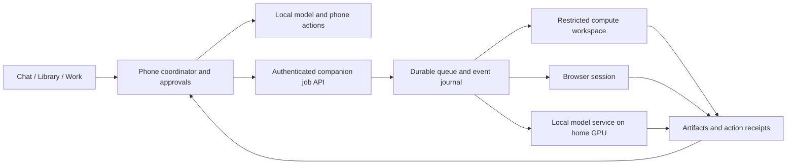

# Cina: optional home companion, model evaluation and consolidation

Date: October 21, 2026. This is the implementation direction from the user's request to explore Docker offload, compare model sizes and consolidate features/tools. It extends the existing personal-agent roadmap. Status is separated below: an architecture decision or Compose file is not evidence of a working companion.

Updated October 22: the user clarified that the optional companion is managed from Cina, including its models and current work, while the phone keeps a useful local model. The interface must remain minimal: **no separate companion destination, dashboard, phone/server tabs, or additional top-level execution selector**. The app integration contract below takes precedence over the earlier inference-first delivery sketch.

Implemented October 22: [the deployable companion](../companion/README.md) now contains a Python HTTPS control service, private Ollama runner, persistent SQLite jobs/events, certificate-pinned pairing and device revocation, model operations, digest-pinned analysis, cancellation tombstones and restart recovery. Cina integrates these into Connections, Models/the existing picker, and Work, with an optional Home assignment for Deep analysis. Phone requests and Android schedules retain their local runtime. Server results are text, never executable phone tool calls. Browser/compute, arbitrary agent workflows, server schedules and whole-document processing remain unimplemented. Deployment includes CPU and NVIDIA Compose configurations. No Docker executable or GPU was available locally, so actual image/GPU execution still requires host/CI validation; the pinned HTTPS Android fixture uses fake inference and does not measure model quality.

## Decisions

- Keep one assistant, one work history and one permission system across phone and server.
- Treat the companion as an app-managed execution location. Models, downloads, jobs and controls appear in the existing app surfaces; server complexity stays behind them.
- The phone must remain useful offline: capture, notes, reminders, reviewed memory, simple chat and bounded local tasks.
- Add an optional self-hosted companion for larger-model inference and durable delegated jobs, then its own browser and computing environment.
- Target the user's Ryzen 5600X and RTX 3070 as the server baseline. NVIDIA specifies 8 GB VRAM. Server RAM/OS are unknown. Assume Linux plus NVIDIA Container Toolkit for the initial Compose experiment; confirm before deployment. The previously documented Fold 7 is a provisional phone target until confirmed.
- Use workflow measurements to choose models and execution routes. A parameter count, valid JSON or a fast token rate alone does not establish competence.
- Consolidate navigation and model-visible choices before expanding the tool catalogue. Preserve the underlying source, approval and action records during this first slice.

## One assistant across two execution locations

The phone owns personal sources, reviewed knowledge, work definitions and grants. The companion receives selected evidence and files for a particular job; it owns that job's execution journal. It returns progress, artifacts, proposals and receipts. It cannot directly edit the phone database or turn observations into accepted memory.

Retain the existing model picker and response controls. Model rows can identify their location with a short secondary label, such as **Phone** or **Home**; selecting a particular model pins that choice. Automatic selection prefers the phone for offline/small tasks and the configured home model for larger or durable work, based on supported capabilities, measured model competence, privacy preference and host availability. The app manages routing, IDs and execution state rather than asking the smallest model to plan its own delegation. Record the chosen location and reason internally; show only the useful location/status in the ordinary conversation or work card. There is no additional Phone/Server mode picker and no automatic hosted-model fallback.

Separate two server capabilities:

1. **Inference offload:** use a larger local model for an interactive response or structured extraction; phone tools and approvals remain on the phone.
2. **Job offload:** submit a durable objective that the server can continue while the phone is disconnected, with its own approved capabilities, context and budget.

A compatible text endpoint implements the first capability only. It does not provide durable work, a browser, pairing, cancellation or verification.

An unavailable server leaves new jobs queued or offers a simpler phone route. A disconnected running job has **status unknown** until reconciled; it must not automatically restart on the phone. A home server must remain powered/networked for its jobs to progress. Docker does not remove that availability requirement.

## App-managed companion with minimal UI — October 22 contract

The companion is a complete worker managed through Cina, not merely a URL for remote text generation. The initial connected release must expose real model and job state, with truthful controls, while reusing the existing navigation.

| Existing surface | Companion behavior | Presentation constraint |
| --- | --- | --- |
| Chat / model picker | Use phone or home models in the same conversation; submit larger work to the home worker and retain its identity | One model list, with a small location label where necessary; no location tabs or extra toolbar controls |
| Models | Show installed/downloadable models for the connected locations; select a model, inspect download progress and manage its files through existing row actions | Retain the current Installed/Discover views; do not duplicate them for the server. Installation/deletion actions make their destination clear |
| Work | Show phone and server jobs, progress, approvals, results and existing pause/cancel/resume actions | Same list/cards and task detail. A secondary status such as “Running · Home” is sufficient; no server-only work area |
| Connections | Pair/unpair the home companion, show connection health and expose infrequent worker controls through the existing connection entry | Reuse Add connection and an inline detail/confirmation flow; no dedicated companion dashboard or new Settings category |

Model downloads run on the selected machine and survive the phone app closing when the destination is Home. Changing the default model affects new work; existing jobs retain their chosen model/configuration. Deleting or unloading a model that is in use must report the conflict or wait for the job to stop, rather than silently breaking active work. Report unavailable hardware/memory metrics as unavailable.

Use a location-aware model reference instead of overloading a phone file path with a server URL or model name. A reference identifies the location, paired server if any, stable model identity/version and backend. Keep actual file paths inside the appropriate executor. The current `LocalModel`, scheduled-task and turn records use local paths; migration must preserve their existing phone meaning and pending work.

The server owns its installed-model inventory, downloads and execution journal; the phone displays a cached view and reconciles it after reconnect. The phone remains authoritative for the user's accepted knowledge, task definition and permissions. Every delegated job receives the relevant bounded context automatically within that task's scope, so the user does not have to reconstruct the conversation for a second assistant. Do not copy the entire phone library or let a worker write directly into it.

The control API must remain available while inference is busy or new job processing is paused. “Pause home work” pauses processing; it is not a claim that a stopped container can restart itself through its own API. Initial host/container installation remains a one-time host setup. Managing work and models does not require giving model tools access to the host Docker daemon.

The present Settings item named Companion edits the avatar. When adding the home connection, call that existing cosmetic item **Appearance** to avoid two meanings of companion. This is a label adjustment within the existing settings surface, not another destination.

### First connected implementation milestone

Ship one end-to-end vertical slice together:

1. Add and authenticate one home companion through Connections; advertise its real model/job capabilities and preserve the pairing securely.
2. Show its actual installed models in the existing Models view and model picker. Select/load a home model and manage one bounded model download with real progress; support safe unload/delete operations through existing row actions.
3. Submit a bounded, read-only analysis job from the existing conversation or Work flow. Persist the job identity before submission; the server acknowledges it durably, pins the model/configuration and reports progress without requiring the phone model to orchestrate the tools.
4. Close the phone app while the server continues. Reopen and reconcile the same job, events, model/download state and result without creating a second execution.
5. Pause/cancel/resume through existing task controls, with explicit acknowledgement and honest interrupted/unreachable states. Server restart must preserve the journal and report interrupted work or resume only from a valid checkpoint.
6. Return a verified result to the same conversation/Work item. Disconnect the server and confirm phone chat, capture, notes and reminders still work locally.

This milestone proves an app-managed worker, not just an inference endpoint. Browser and general computing capabilities then attach to the same jobs, permissions and result surfaces. Begin those capabilities with bounded analysis and artifacts; preserve exact-action review for external side effects. No additional navigation is needed when they arrive.

Introduce the server executor through the shared work contract while preserving existing local receipts and approvals. The connected slice can bridge the existing Work overview before every legacy phone execution path has migrated; complete that migration incrementally rather than adding a second user-facing task system. The existing persistence, verification and permission gates still apply to each newly supported operation.

## Companion services and boundaries

Use a small Compose deployment, initially one active model job:

| Service | Responsibility | Persistent state |
| --- | --- | --- |
| Cina broker/coordinator | Authenticated API, capability checks, queue, approval checks, event replay, reconciliation | Pairing identities, jobs, grants, journal |
| Model service | Replaceable local GGUF inference; same model used for helpers unless explicitly configured otherwise | Read-only model files |
| Worker | Bounded analysis/code tasks in a job-specific workspace | Job outputs and recoverable execution events |
| Browser | Explicitly authorized browsing, later login handoff and visible review | Isolated per-user/session profile with documented retention |
| Artifact store | Hashes, previews, downloads, retention and deletion acknowledgements | Explicitly retained outputs |

These are responsibility boundaries; services may be combined where enforcement and resource limits remain clear. Model tools must not receive the Docker socket, an unrestricted host filesystem mount or broker credentials. The trusted supervisor may manage worker lifetimes outside the model's environment. Browser network egress and compute access need enforcement independent of model instructions. Container isolation alone is not a complete policy boundary.

Prefer API/MCP actions where they are reliable; use browser interaction for workflows those APIs cannot complete. Begin browser validation with local synthetic pages, read-only extraction and downloadable artifacts. Add a user-visible session and private login handoff before real account use. Browser output is untrusted evidence and cannot authorize new actions.

Keep consequential external actions behind exact destination/content approval in the first release. Bind grants to action IDs, arguments, account, capability and expiry. Recheck at the executor. Phone chat YOLO does not become server permission. Credentials stay in a broker-controlled store outside prompts, job artifacts and ordinary compute access.

### Required job contract

Implement pairing/revocation, advertised capabilities, submit, inspect, replay events after a cursor, request/resolve approval, cancel/acknowledge, retrieve artifacts and delete retained job data. A submission includes job/action IDs, revision, objective, selected sources, completion criteria, permitted operations, time/resource budgets and expiry.

Persist before acknowledging submission. Duplicate submission of an ID returns the existing job. Preserve verified step receipts across retries. A timeout after an external write produces a reconciliation state, not an automatic retry. Phone cancellation is pending until the server acknowledges it. Validate artifact size/type/hash before presenting it. Keep source deletion markers so an offline server cannot restore deleted material on reconnect.

### Reuse decision

The existing roadmap names Hermes as the first runtime spike. Its documented Docker deployment and local browser support make it a candidate, not an adopted dependency. Pin a release and inspect all auxiliary model routes, browser defaults, fallback behavior, storage, approval hooks and cancellation semantics. Run the job/recovery contract before selecting it. Keep the model service and job protocol replaceable; use the same criteria for an alternative runtime. Do not install a broad agent gateway simply to get a text endpoint.

## Hardware and model evaluation

On 8 GB VRAM, start with quantized **4B and 8B** dense candidates at one inference slot and 4096 context tokens. These are feasibility hypotheses, not fit/latency guarantees. Weights, context cache, inference buffers, browser RAM and other host workloads all matter. Measure peak use and repeat at 8192 tokens. Treat 12–14B with partial CPU offload as an optional later experiment after confirming RAM and measuring latency; it is not the default target.

Run two distinct experiments:

| Cohort | Sizes and configurations | Purpose |
| --- | --- | --- |
| Existing regression baselines | Qwen3 0.6B / 1.7B Q8_0, already present locally | Reproduce prior fixtures after menu changes; avoid attributing old results to new code |
| Controlled scaling | Qwen3 0.6B / 1.7B / 4B / 8B at matched Q4_K_M; Q8_0 where resources permit | Separate parameter scale from quantization effects within one family |
| Newer compact-family challenge | Qwen3.5 0.8B / 2B / 4B, with 9B considered for the server | Test whether a newer family moves the quality/latency frontier; verify exact GGUF/template/runtime compatibility first |

The newer family's upstream checkpoints are published; exact quantized exports, their revisions and compatibility are a separate selection step. Cina's pinned source includes qwen35 architecture handling, which is not proof that every export, chat template or image path works. Do not enable image processing as a side effect of choosing a multimodal-family text model.

Compare three model menus using the same fixtures: legacy broad grammar, current selected grammar, and proposed task-specific menus. This distinguishes model improvement from interface simplification. Version every corpus and menu; never compare changed corpus scores as one continuous benchmark.

### Evaluation protocol

1. Use the actual production runtime, selected prompt/skill, constrained output schema, parser, coordinator and storage. HTTP-only synthetic prompts are a preliminary server probe; direct phone/server comparison requires a companion fixture adapter.
2. First run the existing eight work controls and two-step continuation. `tools/Measure-CinaModels.ps1` automates a model list and repeat count, checks model transfer hashes, installs the selected built test APKs without uninstalling, and saves unique evidence for each run. It requires an explicit device serial. It reports missing/incomplete evidence and runner crashes separately from capability scores. It does not download models.
3. Expand to the existing roadmap's 30 captures and 10 full workflows, with held-out paraphrases. Include no-tool chat, note/reminder creation, missing times, corrections, source-backed retrieval, compound work, tool discovery, choosing the correct project/account, permission denial, hostile source content and returning a verified result after interruption.
4. Use at least three repetitions during screening. Evaluate cold load separately from warm requests, with fixed context/output budgets and recorded quantization, hash, runtime, sampling and menu. Keep a final held-out validation set.
5. Record exact task success, argument accuracy, clarification quality, unwarranted actions, false completion claims, retries, first answer and whole-task latency. On the physical phone also record memory, battery and thermal behavior; on the 3070 record VRAM and host RAM. An emulator establishes integration behavior only.
6. Choose the smallest model meeting each supported workflow's quality and latency target. Proposed launch gates are zero unauthorized execution/false success on the release corpus and at least 95% exact success for supported bounded actions. These are design targets, not measured results or guarantees beyond that corpus. A model can qualify for chat/extraction without qualifying for action planning.

Existing 4/8 and 7/8 scores are small, historical Q8_0 emulator smoke results. They do not establish that 1.7B is the best phone size or that 4B/8B will be reliable. Fresh evidence from this slice belongs in the validation record rather than being inferred from model size.

## Consolidation of the user experience

The first navigation change groups existing functionality without merging records or expanding execution authority:

| Main destination | Purpose | Included features |
| --- | --- | --- |
| Chat | Ask, explain, draft and steer work | Conversations, attachments, quick capture/track-work entry points |
| Library | Keep and find information | Inbox, notes, knowledge/projects, personal memory, library storage/backup |
| Work | See what Cina is doing or waiting for | Unified overview, approvals, progress, reminders, schedules, results |
| Settings | Configure the assistant | About you/preferences, models, response modes, connections, skills, appearance, permissions |

Existing widgets, notifications, Inbox share capture and result links continue opening their existing destination. Notes and approved knowledge keep their original data; library grouping does not silently merge personal memory with source-backed knowledge. The first slice preserves the specialized work editors. Subsequent work migrates chat goals and scheduled inference into the shared work coordinator, with history/retry compatibility and no double execution. A navigation rename is not completion of that migration.

Use one work identity, one state model and one verified outcome. A reminder is a timed commitment or notification; a routine is a trigger on work; a goal is an objective; an action is an execution step. These become properties of work rather than independent execution systems. Keep these distinctions when they help the user review a commitment, not as competing top-level sections.

## Consolidation of the model interface

The current tool registry includes separate direct note/reminder tools, work-plan controls, schedule tools, tool/skill discovery, attachments/memory search, Android handoffs and a generic connected-tool bridge. Some duplication represents genuinely different authority and must not be erased by a broad universal tool.

Use six conceptual capabilities: **capture**, **retrieve**, **draft/update work**, **inspect/control work**, **request an approved action**, **delegate work**. Backend service adapters retain exact schemas and deterministic validation. Load one relevant procedure and a small operation menu for a step; use application state to track work IDs, revisions, cursor values, continuation and permissions. Never ask the model to approve itself or to invent IDs.

Initial code fix: `AssistantRuntime` now builds its tool grammar from the same `ToolMenu.selected` definitions used in its instructions. Previously ordinary requests used the full registry's grammar despite a smaller prompt menu. A successful local discovery expands the grammar from app-owned available capabilities, not from tool-result text. Failed discovery leaves it unchanged. Continuing a saved plan removes new-plan creation while retaining the append operation. These menus reduce extraneous choices; they do not replace executor permission checks or establish improved model scores without testing.

Next consolidate `local_find` / skill / connected discovery behind an application-owned capability resolver; keep tool/skill types clear internally. When migrating execution, route ordinary requested writes through one coordinator. Retain compatibility adapters for old pending approvals and receipts. Stage this separately from the navigation change and measure the same workflow suite at each step. Merely renaming 30 tools into one huge conditional schema would preserve the decision burden.

## Delivery order and demonstrations

| Slice | Deliverable and proof |
| --- | --- |
| 1: simpler phone | Four main destinations; matching prompt/grammar menus; discovery/continuation regressions; model matrix runner; fresh baseline evidence |
| 2: companion feasibility | Boot the pinned inference container on the actual 3070; compare 4B/8B quality and latency; record server RAM/driver/context limits; fix the model/job protocol |
| 3: app-managed companion | Deliver the October 22 connected milestone: pairing through Connections, real model/download management in Models, and durable read-only jobs in the existing Chat/Work surfaces |
| 4: shared execution | Complete migration of legacy goals and eligible schedules into the same coordinator, preserving receipts, approvals, wait states and restarts |
| 5: browser and compute | Run a bounded job in the server workspace/browser, show progress and review artifacts; prove cancellation, restart and policy enforcement |
| 6: useful connected routines | Email/calendar reads and drafts, then narrowly approved verified writes and quiet change-based monitoring |

The initial inference starter has been replaced by the deployable read-only job service and app integration described at the top of this document. Actual 3070 measurements and Docker-host validation remain outstanding. No release/push to main is part of this implementation.

## Earlier phone consolidation validation (before companion implementation)

Delivered locally: four-destination navigation and Library hub; profile access under Settings; compatible existing widgets/notification routes; direct knowledge-to-source navigation; matching selected tool instructions and grammar; bounded grammar expansion on successful discovery; the native model batch runner; and the inference-only Compose experiment. [Current UI previews](../preview/consolidation-2026-10-21/README.md) show the actual emulator app.

Validation: **69 JVM tests and 108 Android regressions passed**, with **8 opt-in Android tests skipped**. Debug app and test APKs built for the configured ARM64/x86_64 emulator build. Lint reported **0 errors / 66 warnings**. Source-link tests cover the new direct Library route while Inbox's nested knowledge view was previously open. The new search test waits for asynchronous results and scrolls the lazy result list rather than assuming results are composed above the keyboard. Both menu/Library screenshots were visually inspected. Evidence is retained locally in `.tools/companion-consolidation-final-tests.txt` and `.tools/companion-navigation-capture-test.txt`.

Fresh native screening, one run per model, on the Android 16 x86_64 emulator with 6 GiB allocated RAM and CPU inference:

| Model | Work controls | Two-step continuation | Observed limitation |
| --- | --- | --- | --- |
| Qwen3 0.6B Q8_0 | 5/8 | Failed | Saved one draft step, then claimed two were ready. Pause, reminder formatting and missing-time handling also failed. |
| Qwen3 1.7B Q8_0 | 7/8 | Passed | Invented a missing reminder time; runtime validation rejected it and prevented execution. |

Both runs produced complete fresh evidence. The evaluator correctly exited nonzero because neither model passed every fixture; this is a capability result separate from the passing application regression suite. Per-run UUIDs prevented historical evidence reuse, transfer hashes matched the original GGUFs, and the evaluator removed only its own temporary model copies. [Machine-readable results](companion-evaluation-2026-10-21.json) record hashes and exact scope; full synthetic transcripts remain under `.tools/companion-model-baselines-2026-10-21/`.

These single runs do not establish a general success rate, a causal gain from tool-menu changes or a best phone model. The 4B/8B ladder, newer-family challenge, target-phone latency/battery/thermal checks and real 3070 measurements remain pending. Pairing and durable server jobs were added in the subsequent October 22 implementation; browser/compute workers and shared execution migration remain future work.

## Sources

- [Existing Cina personal-agent roadmap](cina-personal-agent-roadmap.md), especially P3–P6, remains the baseline for data ownership, permissions and release gates.
- [Cina recorded model evaluations](work-overview-implementation-2026-10-14.md).
- [NVIDIA RTX 3070 specifications](https://www.nvidia.com/en-us/geforce/graphics-cards/30-series/rtx-3070-3070ti/).
- [llama.cpp Docker images](https://github.com/ggml-org/llama.cpp/blob/master/docs/docker.md), [Docker Compose GPU reservations](https://docs.docker.com/compose/how-tos/gpu-support/), [NVIDIA Container Toolkit](https://docs.nvidia.com/datacenter/cloud-native/container-toolkit/latest/install-guide.html).
- [Qwen3 4B GGUF](https://huggingface.co/Qwen/Qwen3-4B-GGUF), [Qwen3 8B GGUF](https://huggingface.co/Qwen/Qwen3-8B-GGUF), [Qwen3.5 compact models](https://github.com/QwenLM/Qwen3.8/blob/main/README.md).
- Hermes publisher documentation: [Docker](https://github.com/NousResearch/hermes-agent/blob/main/website/docs/user-guide/docker.md) and [browser](https://github.com/NousResearch/hermes-agent/blob/main/website/docs/user-guide/features/browser.md). These establish candidate features; no contract-conformance claim is made.
