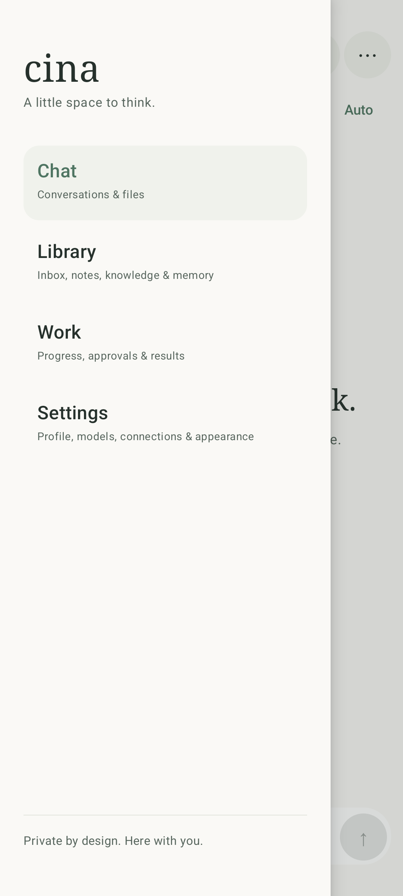
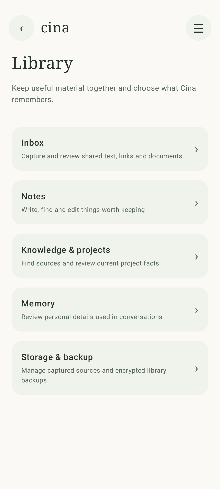

# Consolidated navigation

October 21, 2026. Captured from the Android 16 x86_64 disposable test emulator, using the actual debug app. No model inference was running during these captures. Images were visually inspected after the navigation regression passed.

| Main menu | Library |
| --- | --- |
|  |  |

Chat, Library, Work and Settings are the four main destinations. Library groups existing Inbox, Notes, Knowledge & projects, Memory, and captured-library storage/backup. The existing Work overview and specialized editors retain their execution behavior. See [the companion and consolidation design](../../docs/companion-and-consolidation-2026-10-21.md) for the staged execution changes.
