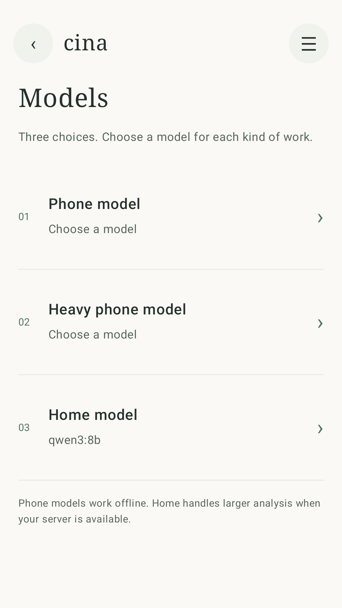
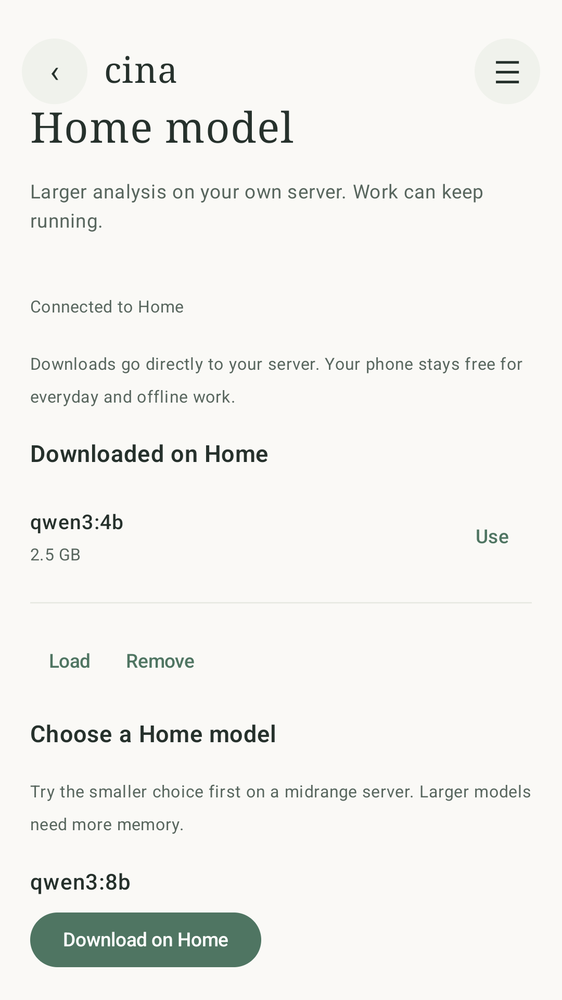
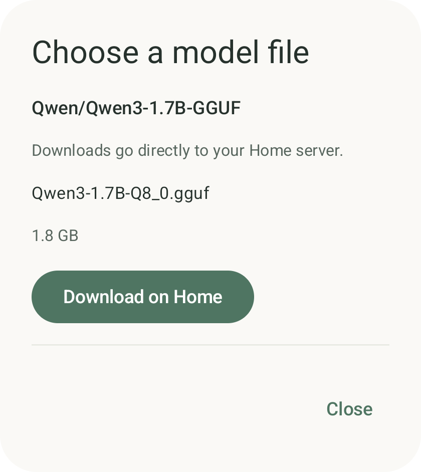

# Model choices and Home downloads

Captured from the actual Android app on a disposable emulator at 1080 × 1920. The Home inventory and inference use a deterministic HTTPS fixture, with simulated model downloads. The Hugging Face dialog uses live public file metadata; the fixture does not download the displayed model weights. These are interface checks, not hardware or model-quality benchmarks.

| Three model choices | Home download | Hugging Face file on Home |
| --- | --- | --- |
|  |  |  |

Phone, Heavy phone and Home keep independent selections. Browsing opens inside the selected choice, and file actions name the download destination. The Home file picker is enabled only when the companion advertises Hugging Face support.
