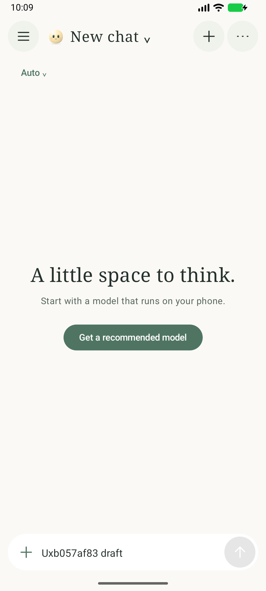
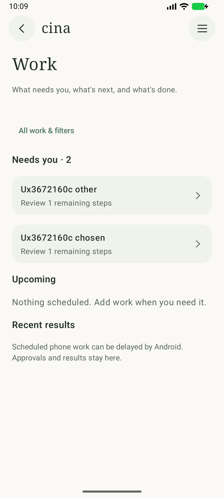
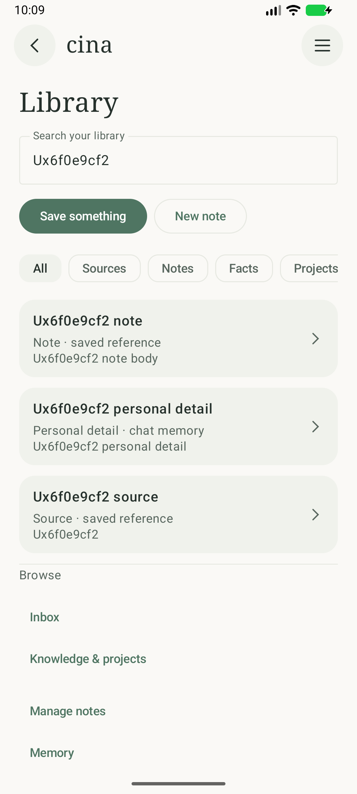
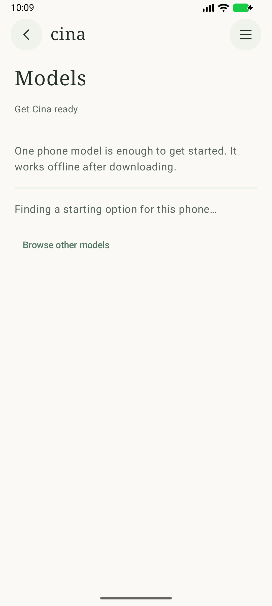
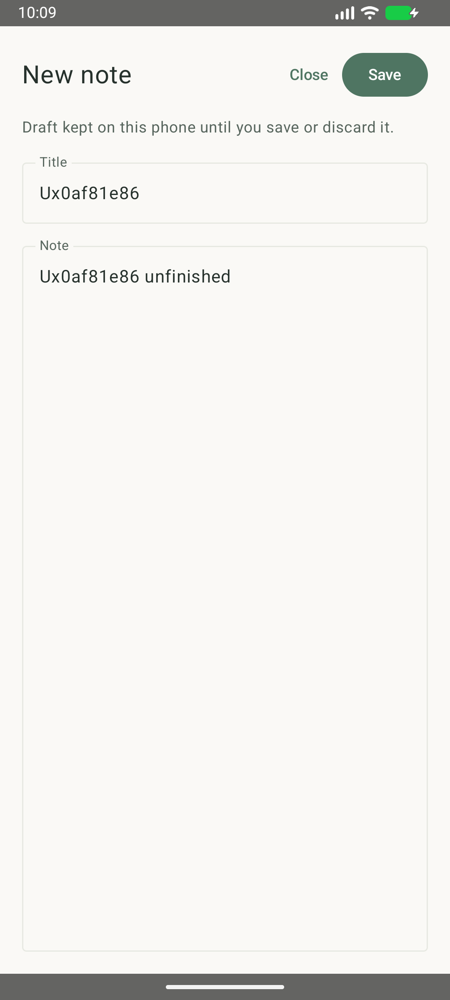
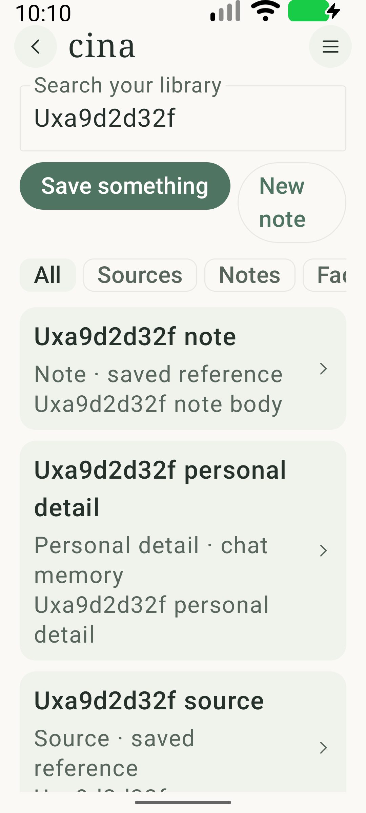
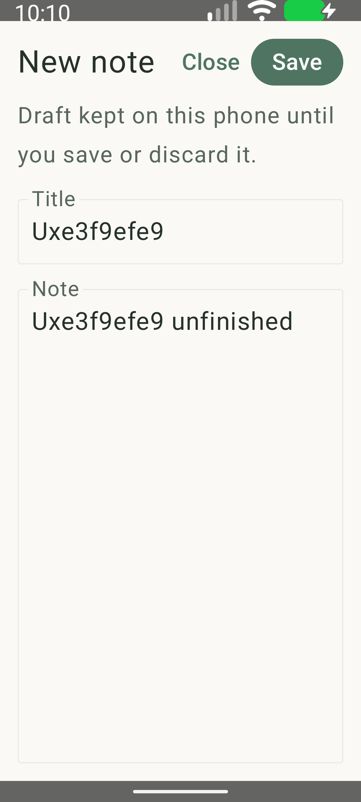
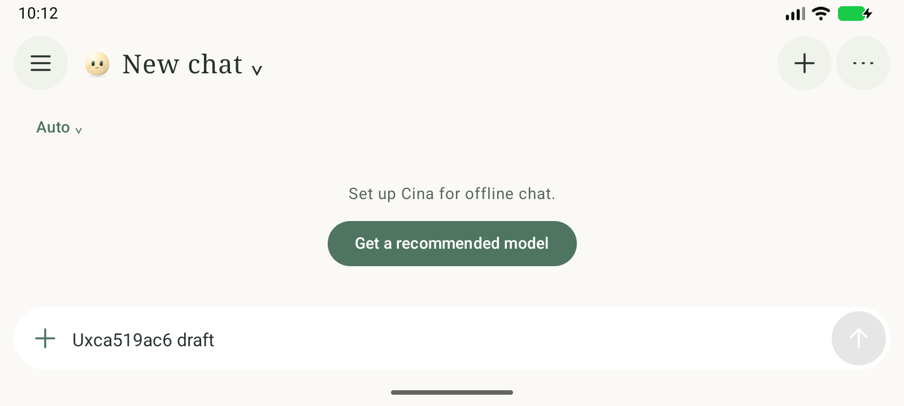
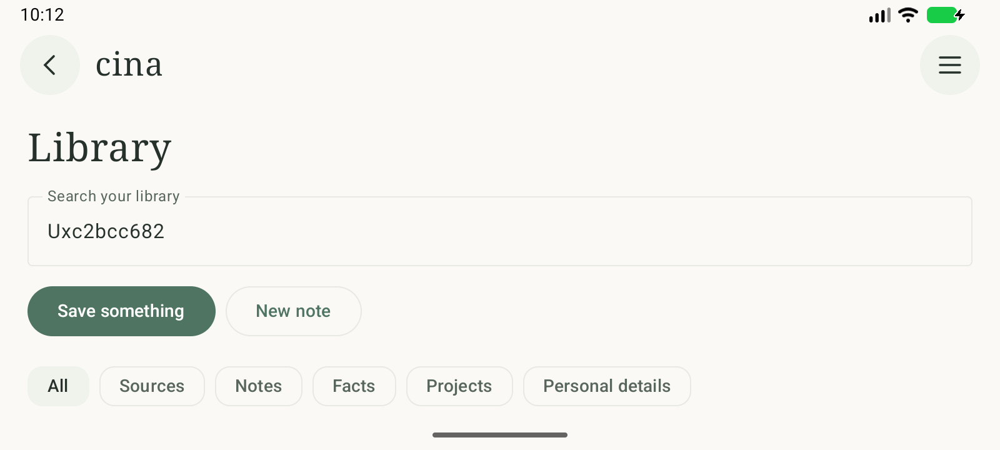

# Cina usability refresh

October 25, 2026. Actual app captures from a disposable Android 16 x86_64 emulator, using generated test records. The `Ux…` names identify test fixtures. These are implementation captures, not mockups or generated images.

See the [implementation notes](../../docs/ui-ux-implementation-2026-10-25.md) for behavior, scope, and remaining device checks.

## Main screens

| Chat | Work | Library |
| --- | --- | --- |
|  |  |  |

## Setup and writing

| Guided setup | Recoverable note draft |
| --- | --- |
|  |  |

The setup capture shows candidate discovery. A separate completion regression verifies return to the original chat draft when a phone model becomes ready; it uses a local installed-model fixture.

## Larger text and landscape

| Library at 200% text | Note at 200% text |
| --- | --- |
|  |  |

## Verification

- Android debug app and test app built successfully; Android lint reported no errors.
- 78 JVM tests passed.
- 27 affected UI regression tests passed in normal portrait mode.
- Three checks passed at 200% text with animator duration scaling disabled: source search/Back, note-draft recovery, and step-type content retention.
- Two checks passed at an 800 × 360dp landscape viewport: source search/Back and model-setup navigation with a fully visible setup action.
- The guided setup completion check passed again after the compact-height layout adjustment.

The normal portrait emulator has a 360 × 800dp display. The tests include top-arrow and Android Back behavior, exact approvals without execution, memory deletion confirmation, draft recovery after recreation, and preserving chat reading position during incoming replies.

Results: [verification summary](verification.json), [portrait UI output](instrumentation.txt), [large-text output](large-text.txt), [landscape output](landscape.txt).

Physical Fold behavior, a complete TalkBack walkthrough, real account sign-in, Home inference, and phone inference speed/battery measurements were not evaluated here.
